<div align="center">

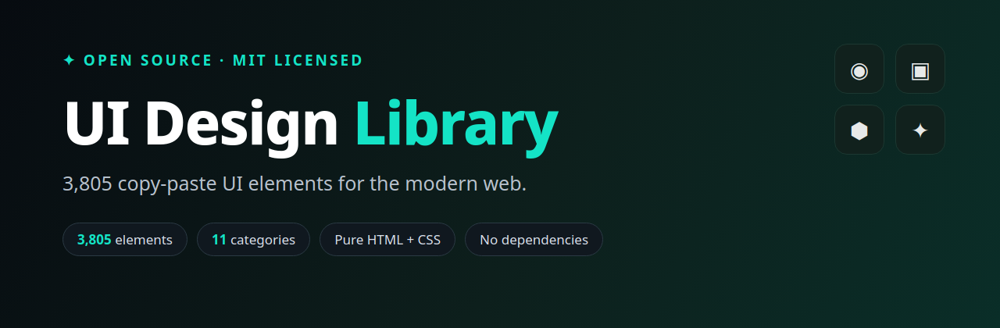

# UI Design Library

**3,805 copy-paste UI elements for the modern web — free, open source, and ready to ship.**

[](uiverse/)
[](uiverse/)
[](UIVERSE-LICENSE.md)
[](https://github.com/mr-10/ui-design-library/commits/main)
[](https://github.com/mr-10/ui-design-library/stargazers)

🌐 **[Visit the live site →](https://mr-10.github.io/ui-design-library/)** — browse all 3,805 elements, search by category, trigger or tag, and copy the code.

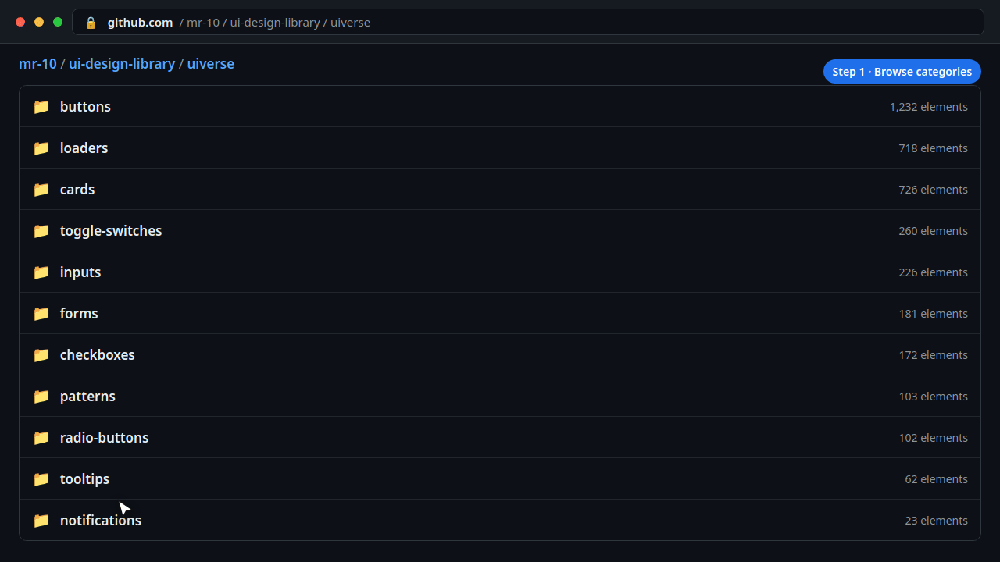

🎬 Prefer video? Watch the [MP4 version](assets/how-to-use.mp4).

</div>

## 📑 Table of Contents

- [About](#-about)
- [Features](#-features)
- [Categories](#-categories)
- [How to Use](#-how-to-use)
- [Use with AI agents](#-use-with-ai-agents)
- [Quick Start](#-quick-start)
- [Preview Gallery](#-preview-gallery)
- [Folder Structure](#-folder-structure)
- [Contributing](#-contributing)
- [License](#-license)

## 📖 About

UI Design Library is a curated collection of **3,805 open-source UI elements** — buttons, loaders, cards, forms, toggles, inputs, and more — gathered from [Uiverse.io](https://uiverse.io) and organized into one searchable library.

It is made for **developers, designers, and students** who want beautiful, production-ready components without starting from scratch. Every element is pure HTML + CSS, works with any framework, and is free to use in personal and commercial projects.

## ✨ Features

- 🎨 **3,805 elements** — one of the largest free UI collections on GitHub
- 🗂️ **11 categories** — buttons, loaders, cards, forms, and more
- 📋 **Copy-paste ready** — every element ships with clean HTML + CSS
- 👀 **Live demos** — each element has a working `index.html` preview
- 🌙 **Dark & light friendly** — elements look great on any background
- 🆓 **MIT licensed** — free for personal and commercial use
- 🔍 **Easy to browse** — consistent folders, names, and READMEs

## 🗂️ Categories

| Category | Elements | Browse |
| :--- | ---: | :--- |
| Buttons | 1,232 | [uiverse/buttons](uiverse/buttons/) |
| Loaders | 718 | [uiverse/loaders](uiverse/loaders/) |
| Cards | 726 | [uiverse/cards](uiverse/cards/) |
| Toggle Switches | 260 | [uiverse/toggle-switches](uiverse/toggle-switches/) |
| Inputs | 226 | [uiverse/inputs](uiverse/inputs/) |
| Forms | 181 | [uiverse/forms](uiverse/forms/) |
| Checkboxes | 172 | [uiverse/checkboxes](uiverse/checkboxes/) |
| Patterns | 103 | [uiverse/patterns](uiverse/patterns/) |
| Radio Buttons | 102 | [uiverse/radio-buttons](uiverse/radio-buttons/) |
| Tooltips | 62 | [uiverse/tooltips](uiverse/tooltips/) |
| Notifications | 23 | [uiverse/notifications](uiverse/notifications/) |
| **Total** | **3,805** | — |

## 🚀 How to Use

1. **Browse** — open the [uiverse](uiverse/) folder and pick a category, e.g. `loaders`.
2. **Open an element** — open an element folder and read its `README.md`, or open `index.html` to see it live.
3. **Copy the code** — copy the HTML from `index.html` and the CSS from `styles.css`.
4. **Paste into your project** — drop the code into your page, tweak the colors, and ship it. That's it.

## 🤖 Use with AI agents

Give your AI coding assistant access to all 3,805 elements through the
[MCP server](mcp/) (`ui-design-library-mcp`, free, no login, no API key).
It searches the library, fetches one element at a time, and keeps the
author credit. Full setup page:
[mr-10.github.io/ui-design-library/#/ai-agents](https://mr-10.github.io/ui-design-library/#/ai-agents).

Add this to your client config (Claude Desktop, Cursor, VS Code, Windsurf):

```json
{
  "mcpServers": {
    "ui-design-library": {
      "command": "npx",
      "args": ["-y", "ui-design-library-mcp"]
    }
  }
}
```

Or with Claude Code, run once:

```bash
claude mcp add ui-design-library -- npx -y ui-design-library-mcp
```

Then ask, for example: *"Add a glowing hover button to my page."* The agent
searches, fetches the best match, and adds it with the author credit.

Prefer the terminal? The same package ships a `ui-lib` command:

```bash
ui-lib search "glowing button"
ui-lib get <id> --format react
ui-lib add <id> --dir ./components
```

Machine-readable data: [`data/index.min.json`](https://mr-10.github.io/ui-design-library/data/index.min.json),
[`data/categories.json`](https://mr-10.github.io/ui-design-library/data/categories.json),
one file per element at `api/<category>/<id>.json`, and
[`llms.txt`](https://mr-10.github.io/ui-design-library/llms.txt).

## ⚡ Quick Start

Paste this into any HTML file and you have a working loader — no setup, no JavaScript:

```html
<!DOCTYPE html>
<html lang="en">
<head>
  <meta charset="utf-8">
  <title>My Site</title>
  <style>
    /* Pasted from UI Design Library — dot spinner by abrahamcalsin */
    .dot-spinner {
      --uib-size: 2.8rem;
      --uib-speed: .9s;
      --uib-color: #183153;
      position: relative;
      display: flex;
      height: var(--uib-size);
      width: var(--uib-size);
    }
    .dot-spinner__dot {
      position: absolute;
      top: 0; left: 0;
      height: 100%; width: 100%;
    }
    .dot-spinner__dot::before {
      content: '';
      height: 20%; width: 20%;
      border-radius: 50%;
      background-color: var(--uib-color);
      animation: pulse .9s ease-in-out infinite;
    }
    @keyframes pulse {
      0%, 100% { transform: scale(0); opacity: .5; }
      50% { transform: scale(1); opacity: 1; }
    }
  </style>
</head>
<body>
  <div class="dot-spinner">
    <div class="dot-spinner__dot"></div>
    <div class="dot-spinner__dot"></div>
    <div class="dot-spinner__dot"></div>
    <div class="dot-spinner__dot"></div>
    <div class="dot-spinner__dot"></div>
    <div class="dot-spinner__dot"></div>
    <div class="dot-spinner__dot"></div>
    <div class="dot-spinner__dot"></div>
  </div>
</body>
</html>
```

## 🖼️ Preview Gallery

| | | |
| :---: | :---: | :---: |
| [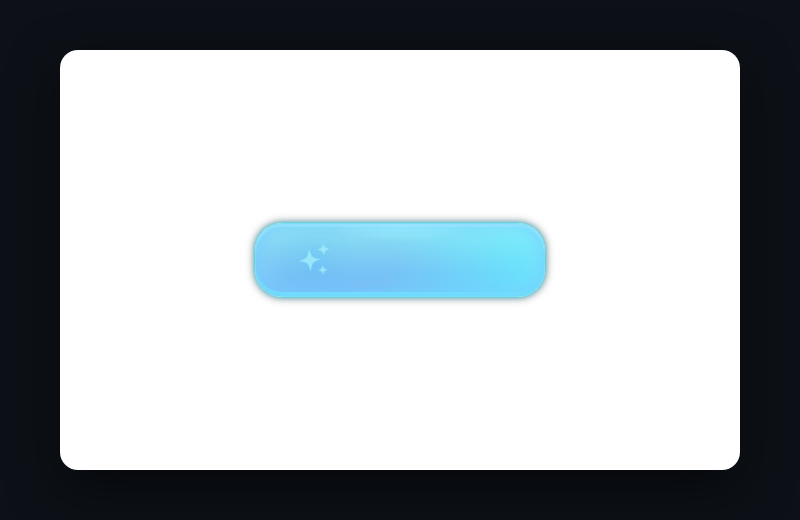](uiverse/buttons/young-newt-20-by-dexter-st)<br>**Sparkle Button** | [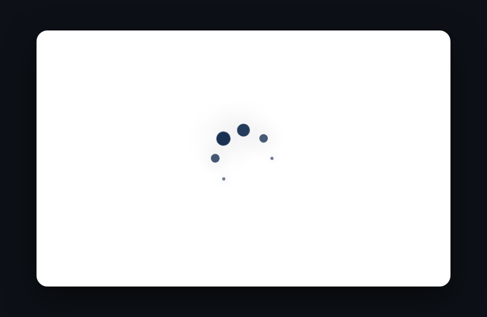](uiverse/loaders/serious-turkey-52-by-abrahamcalsin)<br>**Dot Spinner** | [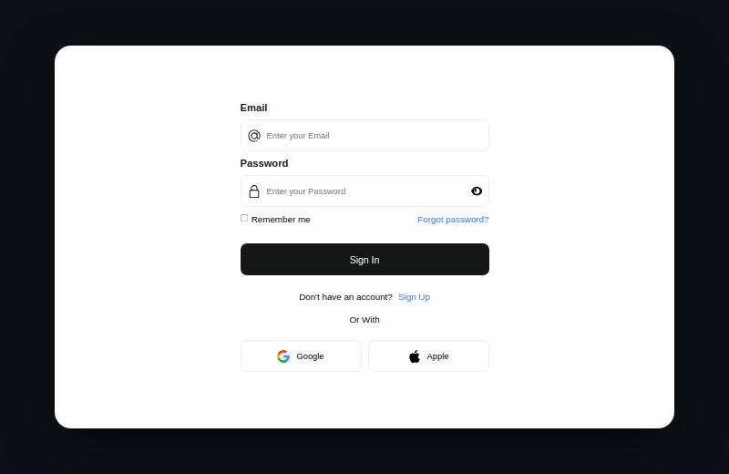](uiverse/forms/dull-walrus-66-by-micaelgomestavares)<br>**Sign-in Form** |
| [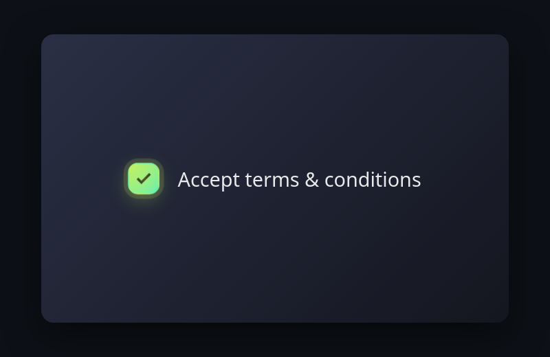](uiverse/checkboxes/tiny-moose-42-by-ahmed_8975)<br>**Glass Checkbox** | [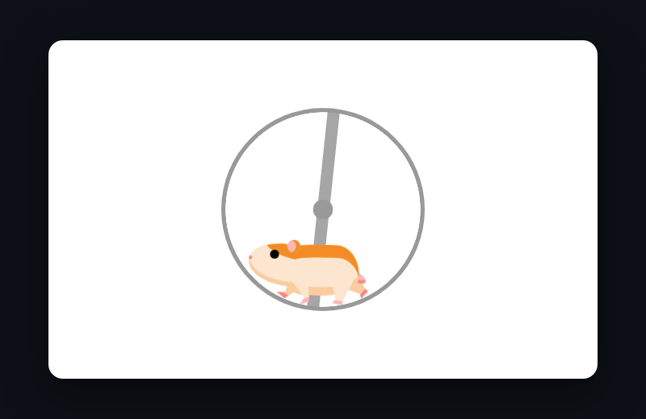](uiverse/loaders/wet-mayfly-23-by-nawsome)<br>**Hamster Wheel** | [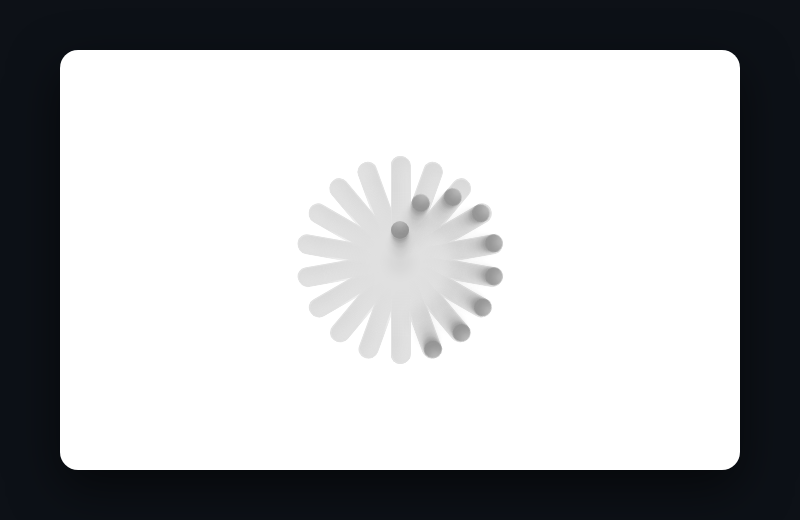](uiverse/loaders/lucky-hound-44-by-praashoo7)<br>**Radial Loader** |
| [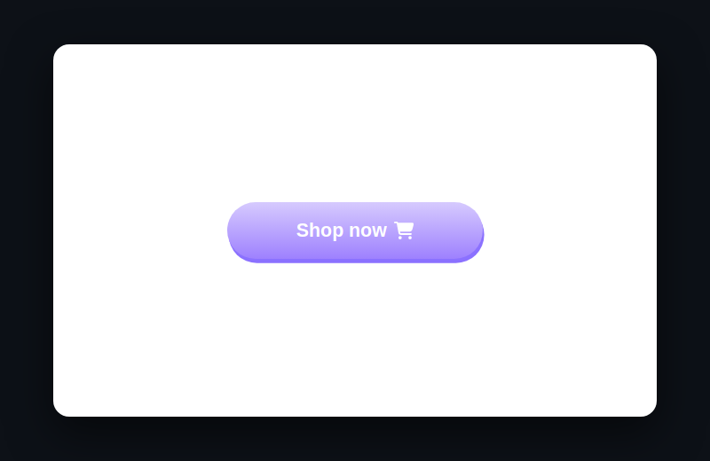](uiverse/buttons/brown-turtle-51-by-vinodjangid07)<br>**Shop Now Button** | [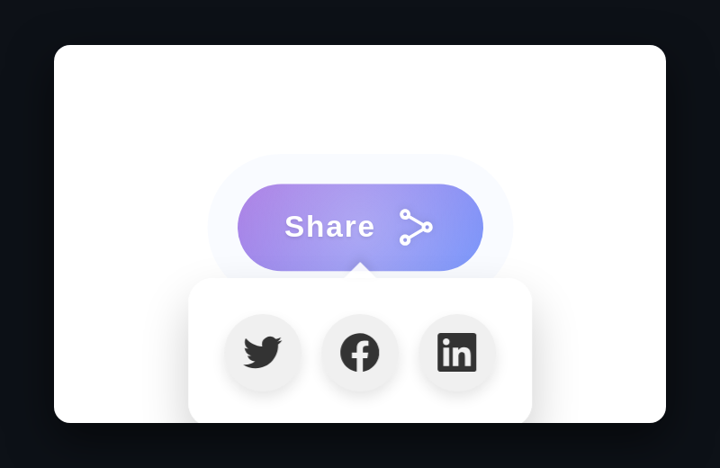](uiverse/tooltips/hard-starfish-64-by-mohammad-rahme-576)<br>**Tooltip** | [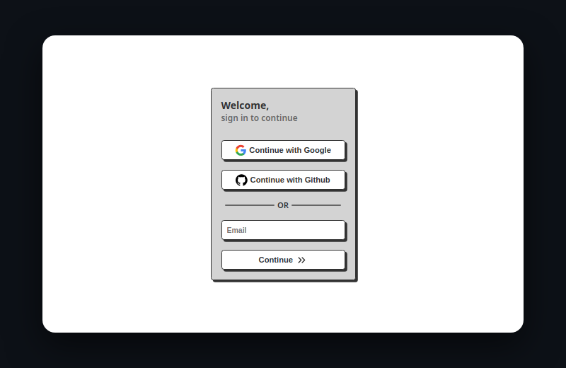](uiverse/forms/short-panther-37-by-d3oxy)<br>**Welcome Form** |

## 📁 Folder Structure

```
ui-design-library/
├── README.md                  # You are here
├── UIVERSE-LICENSE.md         # MIT license note for Uiverse elements
├── assets/                    # Banner, previews, how-to GIF + video
│   ├── banner.png
│   ├── how-to-use.gif
│   ├── how-to-use.mp4
│   └── preview-1.png … preview-9.png
├── docs/
│   └── OLD-README.md          # Previous README (backup)
└── uiverse/                   # 3,805 elements in 11 categories
    ├── buttons/               # 1,232 elements
    ├── loaders/               # 718 elements
    ├── cards/                 # 726 elements
    ├── toggle-switches/       # 260 elements
    ├── inputs/                # 226 elements
    ├── forms/                 # 181 elements
    ├── checkboxes/            # 172 elements
    ├── patterns/              # 103 elements
    ├── radio-buttons/         # 102 elements
    ├── tooltips/              # 62 elements
    └── notifications/         # 23 elements
```

Each element lives in its own folder — `uiverse/<category>/<element-name>-by-<author>/` — with a `README.md`, a working `index.html` demo, and `styles.css`. The author's name and the original Uiverse link are kept in every element's README.

## 🤝 Contributing

Contributions are welcome! To add a design:

1. Fork this repo and create a folder under the right category, e.g. `uiverse/buttons/my-button-by-yourname/`.
2. Add a `README.md` (name, short description, source link, tags, colors), a working `index.html` demo, and `styles.css`.
3. Use a lowercase-hyphen folder name and keep the original author's name and link.
4. Open a pull request — please keep it to one element per PR.

Found a broken demo or a wrong credit? Open an issue and it will be fixed.

## 📄 License

This library is released under the **MIT License** — free to use, copy, modify, and share, for personal and commercial projects. See [UIVERSE-LICENSE.md](UIVERSE-LICENSE.md) for the full note.

All UI elements are originally from [Uiverse.io](https://uiverse.io) and remain under the MIT License. Credit goes to the original authors — each element's README names its creator and links back to the original.

---

<div align="center">

Made with ❤️ by **Rakibul Hasan**

🔗 [GitHub](https://github.com/mr-10) · 🌐 [Portfolio](https://rakib007q.github.io/portfolio/) · 🛒 [BexoBD](https://bexobd.online)

⭐ **If this library helped you, please star this repo — it keeps the collection growing!**

</div>
